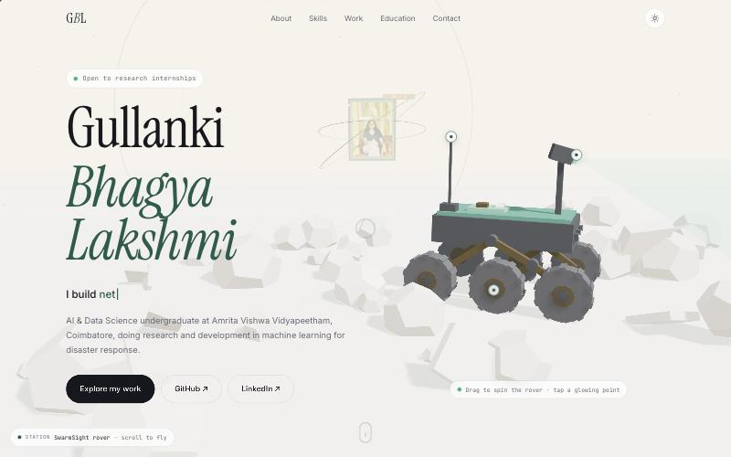

# Gullanki Bhagya Lakshmi · Portfolio

**Live site → [gullankisiri.vercel.app](https://gullankisiri.vercel.app)**

[](https://gullankisiri.vercel.app)

AI & Data Science undergraduate at Amrita Vishwa Vidyapeetham, Coimbatore (CGPA 8.18), doing research and development in machine learning for disaster response.

[LinkedIn](https://www.linkedin.com/in/gullankibhagyalakshmi/) · [Email](mailto:gullankibhagyalakshmi@gmail.com)

## What's inside

A light "mission control" design: blueprint grid, cobalt and signal orange, mono labels and HUD readouts.

- **Drone swarm hero**: a live flocking simulation of quad-drone agents that launch, assemble into her name, veer around the cursor (or your finger), scatter on click and re-form. Pauses offscreen and shows a static formation for reduced motion.
- **Missions**: projects as mission logs with status chips and a schematic of the SwarmSight rover; skills as a systems panel; education as flight telemetry; contact as open comms.
- **Details**: scroll reveals, live counters, mission filters, keyboard focus states and a phone layout.

## Projects featured

| Project | Area | Tech |
|---|---|---|
| SwarmSight: Vision-Based Search & Rescue Robot | Robotics, Computer Vision | YOLO11n, Raspberry Pi 5, NCNN |
| Adaptive PSO for Multi-Robot Search & Rescue | Swarm Intelligence | Particle Swarm Optimisation, Python |
| Mission-Aware Continual Learning for SDR Emergency Networks | Networks, Continual Learning | GNU Radio, SDR, Online Learning |
| AI Complaint Intelligence | NLP, Decision Support | TF-IDF, SVM, Streamlit |
| Protein Secondary Structure Prediction | Computational Biology | Python, Machine Learning |
| YOLO-based Theft Detection | Computer Vision | YOLO, Deep Learning |

## Built with

Plain HTML, CSS and JavaScript (Canvas 2D for the swarm). There are no dependencies and no build step. It is hosted on Vercel, which redeploys on every push to `main`.

## Run locally

```bash
git clone https://github.com/gullanki-06/Portfolio.git
cd Portfolio
python3 -m http.server 5173
# open http://localhost:5173
```

## Files

```
index.html   page content
styles.css   theme, layout and animations
script.js    interactions (nav, reveals, counters, filters, systems scopes)
swarm.js     drone swarm simulation in the hero
assets/      photo and preview image
```
